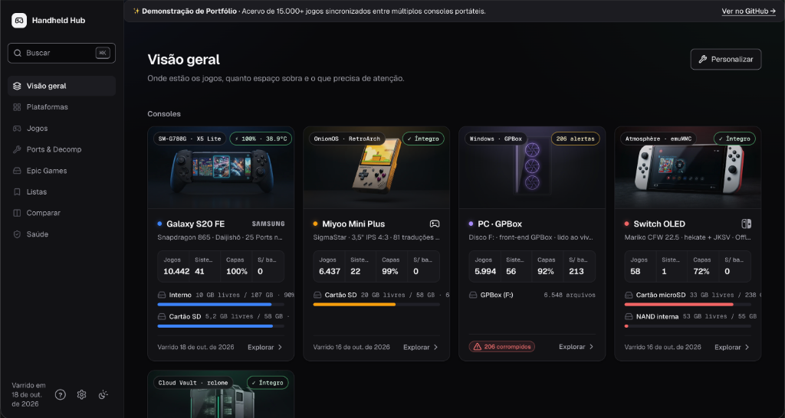

<div align="center">

# Handheld Hub

**Personal gaming dashboard and edge catalog syncing 15,000+ games across 5 devices.**

[](https://handheldhub.gustavoconstantino.com)
[](https://gustavoconstantino.com/work/handheld-hub.html)
[](https://www.linkedin.com/in/gustavoconstantino/)

<br />

[](https://workers.cloudflare.com)
[](https://www.w3.org/WAI/standards-guidelines/wcag/)
[](https://developer.mozilla.org/en-US/docs/Web)
[](LICENSE)

<br />

[Live Showcase](https://handheldhub.gustavoconstantino.com) · [Architecture](#architecture) · [How it works](#how-it-works) · [UI & Design Tokens](#ui-design-tokens--accessibility) · [Local Setup](#local-setup) · [Case Study](https://gustavoconstantino.com/work/handheld-hub.html)

<br />

<a href="https://handheldhub.gustavoconstantino.com">
  
</a>

<p align="center">
  <em>Live dashboard at <a href="https://handheldhub.gustavoconstantino.com">handheldhub.gustavoconstantino.com</a> showing device health, storage telemetry, and library indexing.</em>
</p>

</div>

---

## Why I built this

I have five different places where my games live: an Android phone with a telescoping controller (Galaxy S20 FE + GameSir X5 Lite), a pocket retro handheld (Miyoo Mini Plus), a modded Switch OLED, a living-room emulation PC, and a cold-storage backup on Google Drive.

Across all five, that's **over 15,000 ROMs, native source ports, and saves**. Keeping track of them was painful:
- *Where is game X installed right now?*
- *Which ROMs on the S20 FE SD card got corrupted during a bad write?*
- *Do I already have this game backed up on the Drive before I delete it to free space?*

Existing tools like RomM or LaunchBox either require a 24/7 Docker homelab server or are locked to a desktop OS. I wanted something that loads instantly on both my phone and laptop, costs $0/month to run, doesn't need a build step, and directly reads my hardware over ADB, FTP, and filesystem mounts.

Handheld Hub is that dashboard:
1. **Local Python collectors** scan devices via ADB (`<15ms` per query), local SD mounts, DBI FTP, and cloud storage manifests.
2. **An integrity engine** flags corrupted dumps by checking the first 8 bytes and matches clones across platforms by stripping copier headers (`.smc`, `.smd`).
3. **Cloudflare Workers + D1 (SQLite) + R2** serve the entire catalog with sub-50ms latency and zero egress fees.
4. **A zero-build web frontend** built with pure HTML, modern CSS tokens, and vanilla JavaScript provides instant page loads, full keyboard and gamepad navigation, and strict WCAG 2.2 AA / APCA contrast compliance.

---

## Architecture

```
  DEVICES & SOURCES
  ─────────────────────────────────────────────────────────────────────────────
  Galaxy S20 FE      Miyoo Mini Plus      Switch OLED        PC (GPBox)         Google Drive
  (ADB shell)        (OnionOS mount)      (DBI FTP)          (FTP stream)       (CloudStorage)
       │                    │                  │                  │                  │
       └────────────────────┼──────────────────┼──────────────────┼──────────────────┘
                            v                  v                  v
  LOCAL SCANNER & INTEGRITY (Python 3.9+, zero dependencies)
  ─────────────────────────────────────────────────────────────────────────────
  scanner/scan.py · scripts/catalog.py · scripts/r2_sync.py
  • Magic bytes check : reads 8 bytes to spot zeroed/corrupted dumps instantly
  • CRC-32 dedupe    : strips 512-byte SNES copier headers & de-interlaces Mega Drive
  • Title normalization: NFKD unicode accent folding + canonical system aliases
  • DAT matching     : translates arcade filenames (kof98.zip) to readable titles
  • Secure Enclave   : signs DPoP JWTs with macOS hardware keys for Epic Games sync
                            │
            ┌───────────────┴───────────────┐
            v                               v
  EDGE DATABASE & MEDIA (Cloudflare)
  ─────────────────────────────────────────────────────────────────────────────
  D1 SQLite edge database              R2 bucket (zero egress)
  Structured game_keys & locations     15,000+ WebP box covers (384px, ~35KB)
            │                               │
            └───────────────┬───────────────┘
                            v
  EDGE WORKER & DUAL DOMAINS
  ─────────────────────────────────────────────────────────────────────────────
  gamehub.gustavoconstantino.com       handheldhub.gustavoconstantino.com
  [Private Admin Dashboard]            [Public Portfolio Showcase]
  • Behind Cloudflare Access (SSO/OTP) • Open public access, no login
  • Full download & admin repair tools • Drive downloads disabled via tooltip & modal
                            │
                            v
  FRONTEND (Zero build step, vanilla web standards)
  ─────────────────────────────────────────────────────────────────────────────
  • Semantic HTML5 + CSS custom properties (no framework runtime, no bundlers)
  • Dual-theme token system (WCAG 2.2 AA & APCA Lc ≥ 75)
  • Keyboard command palette (⌘K / /), single-key shortcuts, focus trapping
  • HTML5 Gamepad API (gamepad.js) with D-pad grid navigation & rumble
  • Observable Plot & D3 charts with CVD-tested color palettes
```

---

## How it works

### 1. Device Ingestion
The scanner (`scanner/scan.py`) uses dedicated collectors per platform without installing background agents on the consoles:
- **Galaxy S20 FE (Android):** Runs shell pipelines over ADB (`stat` + `head -c 8`). Scans ~10,400 files across internal UFS and external MicroSD storage in ~18 minutes, reading magic bytes without pulling multi-gigabyte images.
- **Miyoo Mini Plus (OnionOS):** Scans the FAT32 SD card directly on macOS. Validates the `.tmp_update` volume marker before reading, preventing accidental scans of wrong cards.
- **Nintendo Switch (Atmosphère CFW):** Connects to the DBI FTP daemon on the local Wi-Fi. Parses `/JKSV/` directories to track which games have active save files.
- **PC (GPBox):** Streams directory trees over FTP from the living room PC.
- **Google Drive:** Crawls the local macOS `CloudStorage` mirror via `os.stat`. Reads file sizes and timestamps without triggering cloud downloads.
- **Epic Games Library:** `scripts/epic_sync.py` uses Swift `CryptoKit` to sign DPoP OAuth JWTs against macOS hardware **Secure Enclave** P-256 keys, syncing 370+ PC titles headless.

### 2. Integrity Checks & Deduplication
- **Instant corruption detection:** Many bad Android writes produce files where the first 256 KB are filled with zeros. Checking the first 8 bytes flags corrupted `zip`, `chd`, `gcz`, `rvz`, and `nsp` files immediately.
- **Copier header stripping:** Identical games often have different file hashes because older dump tools added 512-byte headers (`.smc` on SNES) or interleaved bytes (`.smd` on Genesis/Mega Drive). The scanner strips headers and de-interlaces in memory so CRC-32 hashes match clean No-Intro dumps.
- **Arcade title resolution:** Files like `kof98.zip` or `sf2.zip` are matched against Libretro MAME and FBNeo DATs to display proper titles (*The King of Fighters '98*, *Street Fighter II*).
- **Repairs:** `scripts/fix_corrupted.py` searches the rest of the collection for healthy copies, verifies their CRC-32, and replaces damaged files automatically.

### 3. Edge Delivery & Payload Optimization
- **Static pre-baking:** Querying Cloudflare D1 on every keystroke previously hit free-tier daily read limits. `scripts/catalog.py` pre-bakes the SQLite database into a normalized `catalog.json` served as a static asset.
- **Payload reduction (−34%):** By extracting random Google Drive file IDs into a separate lookup index, the compressed catalog dropped from **2.2 MB to 1.4 MB**.
- **Media on R2:** ~15,000 box covers are converted to WebP (384px, ~35KB average) and hosted on Cloudflare R2 with immutable HTTP caching and zero outbound egress fees.

---

## UI, Design Tokens & Accessibility

As a Design Systems Engineer, I built Handheld Hub's UI with the same rigor I use in production design systems:

- **Zero-build frontend:** Written in semantic HTML, modern CSS variables, and native ES modules. No React, no Tailwind, no bundler, no `node_modules` deployed to production. Page loads are instantaneous.
- **Color contrast (WCAG 2.2 AA + APCA):** Every text and surface pair satisfies WCAG 2.2 AA (≥ 4.5:1) and APCA (Lc ≥ 75) across both dark and light themes. Secondary text uses `--muted` (#cfcfd5 on dark, #5b5b63 on light), and input borders have a dedicated `--control` token (≥ 3:1).
- **Keyboard-first navigation:**
  - `⌘K` or `/`: Opens the command palette with instant search.
  - `?`: Opens the shortcut help dialog.
  - `g` then `v`: Overview (Visão Geral).
  - `g` then `p`: Platforms.
  - `g` then `j`: Games catalog.
  - `g` then `s`: Health & corrupted files.
  - `t`: Toggles theme.
  - `Esc`: Closes dialogs and restores focus with `preventScroll: true`.
- **Controller support (`gamepad.js`):** Connect an 8BitDo, Xbox, PlayStation, or Switch controller via Bluetooth or USB to navigate the entire game grid with the D-pad and analog sticks, complete with haptic rumble.
- **Color-blindness-safe charts:** Visualizations powered by Observable Plot and D3 use a fixed categorical palette tested for CVD (Color Vision Deficiency) with delta ≥ 8, avoiding confusing red/amber adjacencies.

---

## Dual-Domain Setup

To showcase the project publicly without distributing copyrighted ROMs or leaking private network paths:

| Domain | Access | Behavior |
|---|---|---|
| **`gamehub.gustavoconstantino.com`** | Private | Protected by Cloudflare Access (One-Time PIN / Outlook SSO). Used on my phone and Mac for full file downloads, backups, and repair routines. |
| **`handheldhub.gustavoconstantino.com`** | Public | Open showcase. Direct ROM downloads return `403 Forbidden`. The UI disables the Drive button, shows an informative tooltip (`data-tip`), and opens a modal explaining the legal setup. |

Private mount paths, serials, and local IPs live in `scanner/devices.local.json` (gitignored), while the repo only tracks the sanitized `scanner/devices.json` template.

---

## Devices in the Catalog

| Device | System / OS | Scanner Method | Role | Games |
|---|---|---|---|---|
| **Galaxy S20 FE** | Android 13 (Snapdragon 865) | ADB shell pipeline (`<15ms`) | Primary portable + Daijishō | 10,400+ games · 41 systems · 25 native ports |
| **Miyoo Mini Plus** | OnionOS 4.3 (Linux ARM) | Local SD mount + volume guard | Pocket micro-console (3.5" IPS) | 6,400+ games · 22 systems |
| **Switch OLED** | Atmosphère CFW (Mariko) | DBI FTP daemon | Hybrid handheld + JKSV saves | Installed library + active saves |
| **PC (GPBox)** | Windows 11 Emulation Rig | Streaming FTP crawler | Heavy 3D & arcade emulation | 5,900+ games · 56 systems |
| **Cloud Vault** | Google Drive (rclone) | macOS CloudStorage `os.stat` | Master cold-storage backup | 15,000+ files cataloged |

---

## Local Setup

### Prerequisites
- Node.js 18+
- Python 3.9+ (standard library only; no pip install needed)
- Android SDK platform-tools (`adb` on PATH, if scanning an Android device)

### 1. Clone & install
```bash
git clone https://github.com/guconstantino/handheld-hub.git
cd handheld-hub
npm install
```

### 2. Configure devices
Copy the sanitized template to your local override:
```bash
cp scanner/devices.json scanner/devices.local.json
```
Edit `scanner/devices.local.json` with your real paths, mount points, or ADB serials. This file is gitignored.

### 3. Initialize the database
Apply SQLite migrations to local Cloudflare D1:
```bash
npm run db:migrate
```

### 4. Run a scan & generate catalog
```bash
# Scan connected Android phone over ADB
npm run scan:s20

# Scan your local backup directory
npm run scan:drive

# Pre-bake SQLite data into optimized static catalog
npm run catalog
```

### 5. Start dev server
```bash
npm run dev
```
Open [http://localhost:8787](http://localhost:8787).

---

## Scripts Reference

| Command | What it does |
|---|---|
| `npm run dev` | Starts local Cloudflare Worker on port 8787 |
| `npm run db:migrate` | Runs SQLite schema migrations on local D1 |
| `npm run scan:s20` | Scans Galaxy S20 FE (internal + SD) over ADB |
| `npm run scan:drive` | Scans Google Drive / backup folder on Mac |
| `npm run scan:miyoo` | Scans OnionOS SD card with volume marker check |
| `npm run scan:switch` | Crawls Nintendo Switch DBI FTP for saves and games |
| `npm run scan:epic` | Headless Epic Games sync via macOS Secure Enclave |
| `npm run scan:ports` | Checks native Android source ports against manifest |
| `npm run catalog` | Pre-bakes D1 SQLite data into static `catalog.json` |
| `npm run r2` | Uploads converted WebP box art to Cloudflare R2 |
| `npm run build:static` | Generates a single-file standalone offline HTML bundle |

---

## Project Structure

```
handheld-hub/
├── assets/                 # Icons and preview screenshots
│   ├── icons/              # 24x24 Lucide SVGs optimized for 1.5px stroke
│   └── preview.png         # Dashboard screenshot
├── docs/                   # Detailed documentation (in PT-BR)
│   ├── ARCHITECTURE.md     # Ingestion flow and database schema
│   ├── DECISIONS.md        # Architecture Decision Records (ADRs)
│   ├── LEARNINGS.md        # Platform quirks (Secure Enclave, DPoP, CRC-32)
│   └── ROADMAP.md          # Hardware milestones and plans
├── migrations/             # SQLite migrations for Cloudflare D1
│   ├── 0001_init.sql       # Devices, locations, files schema
│   └── 0002_drive_covers.sql
├── public/                 # Production frontend (deployed to Cloudflare)
│   ├── app.js              # State, routing, and UI rendering
│   ├── hh-api.js           # Client-side catalog search and query engine
│   ├── gamepad.js          # Controller support & haptics via Gamepad API
│   ├── charts.js           # Observable Plot / D3 charts
│   ├── search.js           # Command palette index
│   ├── styles.css          # Design tokens and responsive styles
│   └── data/               # Pre-baked catalog and device specs
├── scanner/                # Ingestion daemons (Python 3.9+)
│   ├── scan.py             # Multi-device collector (ADB, Unix, FTP)
│   ├── devices.json        # Sanitized schema template
│   └── devices.local.json  # Private paths and credentials (gitignored)
├── scripts/                # Sync and build tools
│   ├── catalog.py          # SQLite -> compressed catalog.json
│   ├── epic_sync.py        # Epic Games sync via Secure Enclave
│   ├── r2_sync.py          # Resumable R2 WebP cover uploader
│   └── fix_corrupted.py    # CRC-verified file recovery utility
└── wrangler.jsonc          # Cloudflare Workers configuration
```

---

## Author

**Gustavo Constantino**  
Design Systems Engineer & Senior Product Designer  
Lead Designer for CastanhaDS (Caju) · Ex-Itaú Unibanco · iF DESIGN AWARD 2026 Winner

- Portfolio: [gustavoconstantino.com](https://gustavoconstantino.com)
- Case Study: [gustavoconstantino.com/work/handheld-hub.html](https://gustavoconstantino.com/work/handheld-hub.html)
- LinkedIn: [linkedin.com/in/gustavoconstantino](https://www.linkedin.com/in/gustavoconstantino/)
- GitHub: [@guconstantino](https://github.com/guconstantino)

---

## License & Credits

MIT License. See [LICENSE](LICENSE) for details.

- Device photos: Samsung Galaxy S20 FE by *GadgetsGuy* and Nintendo Switch OLED by *PantheraLeo1359531* ([Wikimedia Commons, CC BY 4.0](https://creativecommons.org/licenses/by/4.0/)).
- Icons: [Lucide Icons](https://lucide.dev) (ISC License) and [Simple Icons](https://simpleicons.org).
- Typography: [Geist](https://vercel.com/font) by Vercel.
